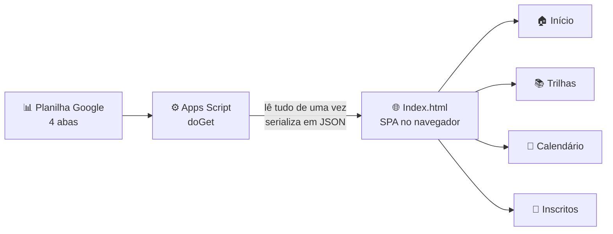

# 🏢 Web App em Apps Script (Portal dos Franqueados) 

 

 

 

 

 

 

> Uma página única onde os franqueados consultam a agenda de treinamentos, a turma atual, o calendário anual e os materiais de apoio, sem precisar procurar em mensagens e pastas. 

 

--- 

 

## 💡 O problema 

 

As datas dos treinamentos, a lista de inscritos e os materiais ficavam espalhados em mensagens, pastas e planilhas. Cada mudança de turma exigia avisar todo mundo de novo. 

 

**Este portal centraliza tudo em um único endereço.** A fonte de dados é uma planilha do Google, então quem atualiza a planilha atualiza o portal, sem mexer em código. 

 

--- 

 

## ⚙️ Tecnologia: roda no Google Apps Script 

 

O projeto é um **Web App do Google Apps Script**. Isso significa que: 

 

- o código roda nos servidores do Google, sem precisar de hospedagem própria; 

- o acesso é feito por uma URL pública do Apps Script, protegida por login Google; 

- os dados vêm direto de uma planilha do Google Sheets, lida pelo próprio script; 

- não há banco de dados, backend separado nem instalação local. 

 

Por isso o código não roda no Python nem fora do Google: ele depende dos serviços do Apps Script (`SpreadsheetApp`, `Session`, `HtmlService`). 

 

--- 

 

## ✨ Telas 

 

| Tela | O que o franqueado encontra | 

|------|------------------------------| 

| 🏠 **Início** | Mini calendário, atalhos para os programas e links rápidos | 

| ⚡ **Programa A e Programa B** | Cronograma semanal da turma atual, com dias, horários e tipo de atividade (live, estudo, rota, feriado) | 

| 📅 **Calendário Anual** | Visão mês a mês das turmas, com datas, modalidade e status | 

| 👥 **Inscritos** | Lista da turma atual de cada programa, com franquia, função e etiqueta | 

| 🔗 **Links importantes** | Glossário, book do franqueado, apostila, plataforma de cursos e painel de acompanhamento | 

 

O status de cada atividade é calculado automaticamente pela data de hoje: **Realizado**, **Em andamento**, **Agendado** ou **Feriado**. 

 

--- 

 

## 🏗️ Arquitetura 

 



 

O servidor faz **uma única leitura** das fontes e entrega a página com os dados já embutidos. A navegação entre as telas acontece no navegador, sem recarregar a página. 

 

--- 

 

## 🔐 Controle de acesso 

 

O Apps Script identifica o e-mail de quem acessa e libera o portal somente para domínios permitidos (lista `ALLOWED_DOMAINS`). Quem não estiver na lista vê a página sem os dados. 

 

Como cada visitante lê a planilha com a própria conta, a planilha precisa estar compartilhada com os leitores. 

 

--- 

 

## 🧠 Destaques técnicos 

 

- **Resiliência por fonte:** cada leitura roda isolada. Se uma aba falhar, as outras continuam funcionando, e o erro fica registrado para diagnóstico. 

- **Colunas pelo nome:** o script localiza as colunas pelo cabeçalho, então a ordem pode mudar sem quebrar o portal. 

- **Leitura de grade de horários:** a planilha de cronograma tem formato de grade (dias nas colunas, horários nas linhas). O código converte cada célula em um evento com data, horário, título e tipo. Como a planilha não tem ano, o ano é deduzido pelo mês atual. 

- **Limpeza de duplicatas:** feriados que aparecem repetidos na grade original são removidos. 

- **Dois programas, um código:** a mesma lógica atende os dois programas, mudando apenas a aba de origem. 

 

--- 

 

## 📁 Estrutura do projeto 

 

``` 

portal-franqueados/ 

├── apps-script/ 

│   ├── Code.gs        # servidor: leitura das planilhas e controle de acesso 

│   └── Index.html     # front-end: HTML, CSS e JavaScript de todas as telas 

└── README.md 

``` 

 

--- 

 

## ⚙️ Como configurar 

 

**1. Planilha de dados** com estas abas: 

 

| Aba | Conteúdo | 

|-----|----------| 

| `Calendario_Anual` | Uma linha por mês e turma (colunas: Mês, Turma/Programa, Data Início, Data Fim, Modalidade, Status, Observações) | 

| `Programa A` e `Programa B` | Grade semanal, com uma linha de cabeçalho no formato `Segunda (05/10)`. Atividades de curso marcadas como `(Curso)` | 

| `Inscritos` | Dois blocos, com títulos `INSCRITOS PROGRAMA A` e `INSCRITOS PROGRAMA B`, cada um seguido do cabeçalho de colunas | 

 

**2. Apps Script:** em [script.google.com](https://script.google.com), crie um projeto, cole o conteúdo de `apps-script/Code.gs` e crie um arquivo HTML chamado `Index.html` com o conteúdo de `apps-script/Index.html`. 

 

**3. Ajuste as constantes** no topo do `Code.gs`: `SHEET_ID` (ID da sua planilha), os nomes das abas e `ALLOWED_DOMAINS` (domínios de e-mail autorizados). 

 

**4. Publique:** em **Implantar → Nova implantação → Aplicativo da Web**, configure: 

- *Executar como:* Usuário que acessa o app 

- *Quem pode acessar:* Qualquer pessoa na organização 

 

**5. Compartilhe** a planilha de dados com os leitores. 

 

--- 

 

## 🔭 Próximos passos 

 

- Gerar o mini calendário da tela inicial a partir dos dados. Hoje ele está fixo no HTML. 

- Separar o CSS e o JavaScript do `Index.html` em arquivos próprios. 

- Criar testes para o parser de cronograma (`parseCelulaCronograma_`), que é a parte mais sensível a variações de formato. 

 

--- 

 

## 🛠️ Tecnologias 

 

`Google Apps Script` · `JavaScript` · `HTML` · `CSS` · `Google Sheets` · `Font Awesome` · `Montserrat` 

 

--- 

## 👤 Autor 

Maria Eduarda Tavares — https://www.linkedin.com/in/madulv/ 
